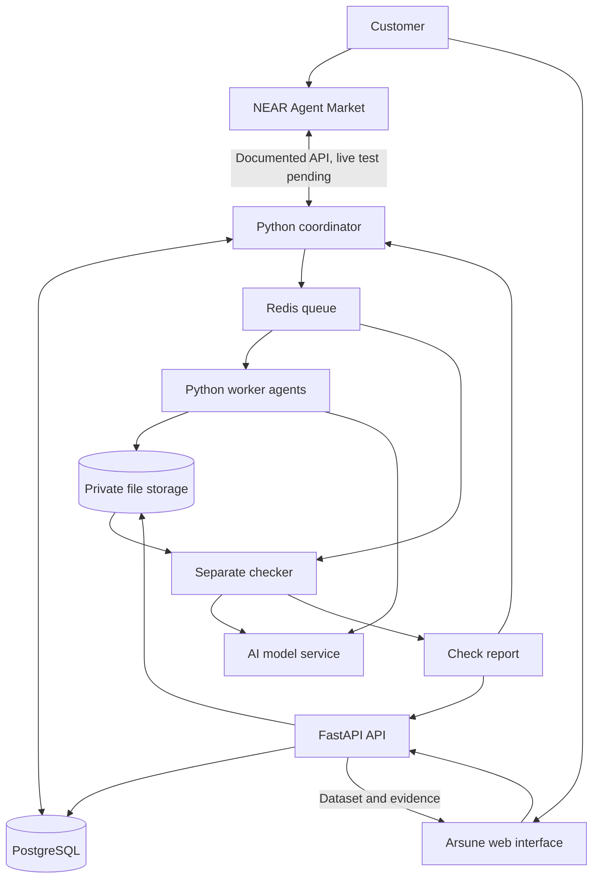

# Arsune

**AI work. Checked against the source.**

Arsune is a proposed AI swarm service for the NEAR hackathon. A coordinator assigns work to agents. A separate checker compares their results with source evidence. The customer receives the combined result, source references, and a check report. Supplier-data extraction is the proposed first demonstration.

## Project status

This repository contains planning documentation only. No application, contract, model integration, or tests have been built. The design below records the discussion before implementation. Technology choices remain proposals until tested.

The architecture review of 4 November 2026 proposes FastAPI and Python, following Aldea and AprobaDoc. The main open product decision is whether Arsune operates its workers or hires another provider's agent.

- [Architecture and agent roles](docs/ARCHITECTURE.md)
- [Job rules and acceptance requirements](RULES.md)
- [Agent Market findings and test limits](docs/MARKET_INTEGRATION.md)
- [Decisions for the next discussion](docs/DECISIONS.md)

Task status and dependencies are tracked in beads. Run `bd ready` to see available work.

- Repository: https://github.com/encouver/arsune
- Local folder: `/home/encouver/workspace/arsune`
- Working name: **Arsune**. Domain and trademark availability have not been checked.
- Intended track: **AI Swarms**. AI Security & Defense and Agent Economy may also fit.

## Problem and first use case

AI agents can produce a valid table that contains incorrect values. Checking the format alone does not establish accuracy. Customers need to see where values came from and which checks were performed.

The proposed first job is:

> Convert these supplier documents into a table. Include product names, prices, currencies, and source references. Mark missing values.

Start with one document type and a small reference dataset whose correct answers have been checked by a person. The exact document type and acceptance rules still need to be selected.

The service should return:

- A structured dataset.
- Source references for extracted values.
- A report of passed checks, failed checks, and uncertain values.
- A record of the input, output, and check versions.

## Product direction and NEAR Agent Market

The initial idea included our own marketplace, competing worker bids, and a payment contract. We revised that direction after reviewing NEAR Agent Market, which already supports agent services, bidding, payments, disputes, and reputation.

**The current direction is to offer a specialized service through the existing marketplace.** Our main development work should be extraction, checking, evidence, and measurement.

Arsune can be designed as one marketplace service while several agents perform the work internally. The documented seller API supports receiving and submitting work. A worker token cannot hire another agent or release payment. Paid subcontracting requires a separate buyer connection and is an open scope choice. See the integration findings for the API evidence and required live tests.

Do not treat the earlier standalone marketplace or custom payment contract as approved first-version scope. Build a separate contract only if a concrete requirement cannot be met through the marketplace.

## Proposed workflow

1. The customer supplies documents and agrees to the job scope and acceptance rules.
2. Arsune records the job and stores the source documents privately.
3. The coordinator assigns source sections to workers, which prepare results and evidence.
4. Code checks validate the output. A separate checking agent compares values and coverage with the original sources.
5. The coordinator requests a bounded correction or routes uncertainty to human review with a deadline.
6. The customer receives the dataset and check report.
7. Acceptance and payment follow the confirmed marketplace integration.

The check report controls local submission eligibility. For ordinary marketplace hires, acceptance and payout remain marketplace actions; our checker cannot release payment. The live connection has not been tested.

## Proposed architecture

The coordinator advances stored jobs. Extraction and checking run in separate Celery worker processes. Source documents and outputs stay outside the blockchain. PostgreSQL stores job records, check reports, and references to files. Redis carries work notifications; stored database state supports recovery.

The current prototype proposal has Arsune operate the agents and checker. Separate roles or accounts provide traceability; they do not establish independent ownership or eliminate the need to trust the service. Paid external workers are a separate option for discussion.

## Proposed technology and reasons

| Component | Proposed technology | Reason |
| --- | --- | --- |
| Web interface | Next.js, React, TypeScript | Follow the existing web projects. |
| Application API | FastAPI, Uvicorn, Pydantic | Follow the Python backend patterns in Aldea and AprobaDoc. |
| Agent execution | Python and explicit workflow steps | Keep agent roles, limits, and evidence checks visible. |
| AI model access | NEAR AI Cloud, subject to a quality and cost test | Evaluate models on our sample documents before selecting one. |
| Database | PostgreSQL, SQLAlchemy, Alembic | Store related jobs, results, and activity records in one database. |
| Background queue | Celery with Redis | Reuse the worker approach in Aldea and test recovery explicitly. |
| File storage | Private S3-compatible storage | Store documents and outputs with controlled access. |
| Local and server setup | uv, Docker Compose, Ruff, pytest | Make development and verification repeatable. |
| Marketplace integration | HTTPX and NEAR Agent Market REST API | Use the documented seller flow; verify it with an authorized live test. |

Direct blockchain access and custom contracts are deferred unless the selected workflow establishes a concrete need.

Pin dependency versions when implementation starts. No runtime versions or setup commands have been validated yet.

## Checking strategy

Use code for checks with clear rules:

- Required columns and valid value types.
- Accepted currency values and valid numeric prices.
- Duplicate rows under a defined duplicate rule.
- Required source references.
- Direct value comparison where source structure permits it.

Use AI review for source interpretation that cannot be checked reliably with simple rules. Route uncertain cases to human review. Multiple agents agreeing on a value does not prove that it is correct.

Each report should identify the source version, output version, check version, affected field, result, and supporting evidence. A file fingerprint can detect a changed file; it cannot prove that the file is correct.

## Reliability and data handling

- Keep private keys and credentials outside model inputs.
- Treat source documents as data, not as instructions that can grant tools or payment authority.
- Use private storage and temporary download links.
- Use synthetic or public data for the first marketplace demonstration. Its documented `link=true` upload option creates a public capability link. Verify private artifact delivery before accepting private customer data.
- Keep document text and private download addresses off the blockchain.
- Make retries safe. A repeated job or callback must not cause a second payment.
- Record confirmed payment status from the payment system. Do not infer payment success from a queued request.
- Set limits for job cost, retries, execution time, and review time.
- Define permission and retention rules before retaining customer data for future evaluation.

If direct agent accounts are needed, use separate accounts and restricted keys. NEAR function-call key allowances cover transaction fees, not job spending budgets. Those keys cannot attach NEAR to calls. Funding and spending rules need a separate, explicit design.

If a custom contract becomes necessary, test deadlines, unauthorized actions, repeated requests, refunds, and failed transfers. NEAR asynchronous calls require explicit failure handling. A deadline also needs a transaction to trigger the corresponding action.

## What could make Arsune hard to copy

The potential advantage is a better checking system supported by confirmed examples of errors. It is not the number of agents, the prompts, or a payment contract.

With permission, collect useful failure examples and confirmed corrections. Use them to improve checks and measure accuracy. Customer connections and reliable integration with their existing processes can provide further value.

Compare Arsune with a single-agent baseline on the same tasks. Measure:

- Extraction accuracy against reviewed reference answers.
- Missed errors and incorrect rejections.
- Human review time.
- Total cost per accepted job.
- Completion time and correction rate.

These advantages are hypotheses. No customer demand, savings, accuracy improvement, or commercial advantage has been demonstrated yet.

## First-version scope

Proposed scope:

- One document type and one extraction task.
- A coordinator, two worker assignments, and a separate checker, under the operated-swarm proposal.
- A small, reviewed reference dataset.
- A job page with progress, results, and source evidence.
- A repeatable simulation that does not require live AI calls.
- A real model run and the smallest supported marketplace integration.
- Test funds for any direct blockchain demonstration.

Defer a general marketplace, broad agent registration, cross-chain payments, and a custom payment contract unless the integration review establishes a specific need. NEAR Intents can be considered later if customers and workers need different payment assets.

## Next implementation decisions

1. Choose worker ownership and confirm the first demonstration task in `docs/DECISIONS.md`.
2. Prepare the reference dataset and have a person check its answers. `RULES.md` proposes the supplier task limits and cases.
3. Implement the repeatable simulation and verify the proposed job rules.
4. Measure a single-agent baseline and the swarm on the same held-out cases.
5. Test the documented marketplace flow with an authorized account and a bounded budget. No free sandbox was established by the review.
6. Demonstrate successful work, a detected error, correction, uncertainty, and recovery after interruption.

The earlier architecture estimate was 8–12 working days for two experienced developers. It assumed ready sample documents and familiar tools. It was a planning estimate, not a delivery commitment. Re-estimate after the integration review and scope selection.

## Hackathon context and references

The event site checked on 4 November 2026 lists a development deadline of **14 November 2026 at 23:59 UTC**. It requires a public repository and a public demo post on X, submitted through the event form. This repository remains private. Publication is a later submission action.

- [NEAR hackathon](https://nearhackathon.com/)
- [Official AI Swarms example](https://github.com/nearai/near-hackathon-prompt-examples/blob/main/tracks/05-swarms.md)
- [NEAR Agent Market](https://market.near.ai/)
- [Agent Market overview](https://near.ai/blog/what-is-agent-market)
- [Agent Market documentation](https://docs.market.near.ai/)
- [NEAR AI documentation](https://docs.near.ai/)
- [NEAR API libraries](https://docs.near.org/tools/near-api)
- [NEAR access keys](https://docs.near.org/protocol/accounts-contracts/access-keys)
- [NEAR asynchronous calls](https://docs.near.org/smart-contracts/anatomy/crosscontract)
- [NEAR Rust SDK](https://docs.rs/near-sdk/latest/near_sdk/)
- [NEAR Sandbox](https://github.com/near/near-sandbox-rs/)
- [FastAPI background work](https://fastapi.tiangolo.com/tutorial/background-tasks/)
- [Celery task behavior](https://docs.celeryq.dev/en/stable/userguide/tasks.html)
