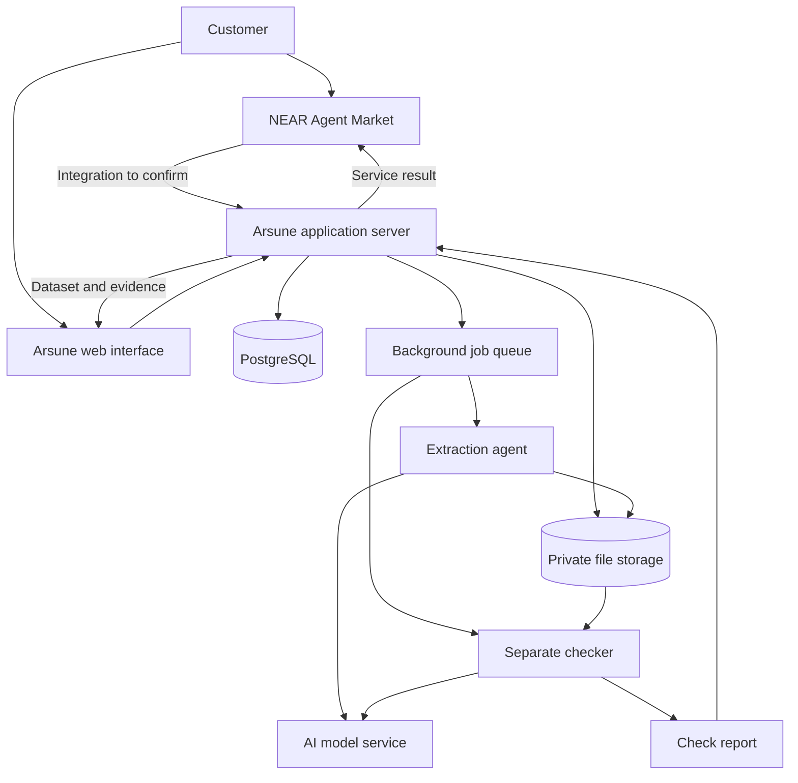

# Arsune

**AI work. Checked against the source.**

Arsune is a proposed service for the NEAR hackathon. AI agents extract structured data from source documents. A separate checker compares the results with the sources. The customer receives the dataset, source references, and a check report.

## Project status

This repository contains planning documentation only. No application, contract, model integration, or tests have been built. The design below records the discussion before implementation. Technology choices remain proposals until tested.

- Repository: https://github.com/encouver/arsune
- Local folder: `/home/encouver/workspace/arsune`
- Working name: **Arsune**. Domain and trademark availability have not been checked.
- Intended track: **AI Swarms**. AI Security & Defense and Agent Economy may also fit.

## Problem and first use case

AI agents can produce a valid table that contains incorrect values. Checking the format alone does not establish accuracy. Customers need to see where values came from and which checks were performed.

The proposed first job is:

> Convert these supplier documents into a table. Include product names, prices, currencies, and source references. Mark missing values.

Start with one document type and a small reference dataset whose correct answers have been checked by a person. The exact document type and acceptance rules still need to be selected.

The service should return:

- A structured dataset.
- Source references for extracted values.
- A report of passed checks, failed checks, and uncertain values.
- A record of the input, output, and check versions.

## Product direction and NEAR Agent Market

The initial idea included our own marketplace, competing worker bids, and a payment contract. We revised that direction after reviewing NEAR Agent Market, which already supports agent services, bidding, payments, disputes, and reputation.

**The current direction is to offer a specialized service through the existing marketplace.** Our main development work should be extraction, checking, evidence, and measurement.

Arsune could appear as one service in the marketplace while several agents perform the work internally. Marketplace integration, internal worker payments, and result acceptance behavior need to be confirmed against its current API.

Do not treat the earlier standalone marketplace or custom payment contract as approved first-version scope. Build a separate contract only if a concrete requirement cannot be met through the marketplace.

## Proposed workflow

1. The customer supplies documents and agrees to the job scope and acceptance rules.
2. Arsune records the job and stores the source documents privately.
3. An extraction agent prepares the dataset and source references.
4. A separate checker runs code checks and compares values with the sources.
5. Uncertain results enter a defined review process. Corrections must have a retry limit.
6. The customer receives the dataset and check report.
7. Acceptance and payment follow the confirmed marketplace integration.

The exact relationship between the check report and payment release remains an integration decision. Do not claim that marketplace payments automatically follow our checker until that behavior is implemented and tested.

## Proposed architecture

The server coordinates jobs. Extraction and checking run as background tasks. Source documents and outputs stay outside the blockchain. The database stores job records, check reports, and references to files.

For the prototype, we operate the agents and checker. Separate roles or accounts provide traceability; they do not establish independent ownership or eliminate the need to trust the service.

## Proposed technology and reasons

| Component | Proposed technology | Reason |
| --- | --- | --- |
| Web interface and application server | Next.js, React, TypeScript | Keep the interface and server in one project and share data definitions. |
| Agent execution | Node.js and TypeScript | Use explicit job steps, bounded retries, and allowed actions. |
| AI model access | NEAR AI Cloud, subject to a quality and cost test | Evaluate models on our sample documents before selecting one. |
| Database | PostgreSQL | Store related jobs, results, and activity records in one database. |
| Background queue | pg-boss | Use PostgreSQL for queued tasks and avoid a separate queue service initially. |
| File storage | Private S3-compatible storage | Store documents and outputs with controlled access. |
| Local and server setup | Docker | Make the development and execution environment repeatable. |
| Marketplace integration | NEAR Agent Market API, pending review | Reuse existing service discovery and payment functions. |
| Direct NEAR access, if needed | near-api-js and NEAR Wallet Selector | Support server transactions and customer wallet access. |
| Custom contract, only if required | Rust with near-sdk | Implement narrowly defined payment rules on NEAR. |

Pin dependency versions when implementation starts. No runtime versions or setup commands have been validated yet.

## Checking strategy

Use code for checks with clear rules:

- Required columns and valid value types.
- Accepted currency values and valid numeric prices.
- Duplicate rows under a defined duplicate rule.
- Required source references.
- Direct value comparison where source structure permits it.

Use AI review for source interpretation that cannot be checked reliably with simple rules. Route uncertain cases to human review. Multiple agents agreeing on a value does not prove that it is correct.

Each report should identify the source version, output version, check version, affected field, result, and supporting evidence. A file fingerprint can detect a changed file; it cannot prove that the file is correct.

## Reliability and data handling

- Keep private keys and credentials outside model inputs.
- Treat source documents as data, not as instructions that can grant tools or payment authority.
- Use private storage and temporary download links.
- Keep document text and private download addresses off the blockchain.
- Make retries safe. A repeated job or callback must not cause a second payment.
- Record confirmed payment status from the payment system. Do not infer payment success from a queued request.
- Set limits for job cost, retries, execution time, and review time.
- Define permission and retention rules before retaining customer data for future evaluation.

If direct agent accounts are needed, use separate accounts and restricted keys. NEAR function-call key allowances cover transaction fees, not job spending budgets. Those keys cannot attach NEAR to calls. Funding and spending rules need a separate, explicit design.

If a custom contract becomes necessary, test deadlines, unauthorized actions, repeated requests, refunds, and failed transfers. NEAR asynchronous calls require explicit failure handling. A deadline also needs a transaction to trigger the corresponding action.

## What could make Arsune hard to copy

The potential advantage is a better checking system supported by confirmed examples of errors. It is not the number of agents, the prompts, or a payment contract.

With permission, collect useful failure examples and confirmed corrections. Use them to improve checks and measure accuracy. Customer connections and reliable integration with their existing processes can provide further value.

Compare Arsune with a single-agent baseline on the same tasks. Measure:

- Extraction accuracy against reviewed reference answers.
- Missed errors and incorrect rejections.
- Human review time.
- Total cost per accepted job.
- Completion time and correction rate.

These advantages are hypotheses. No customer demand, savings, accuracy improvement, or commercial advantage has been demonstrated yet.

## First-version scope

Proposed scope:

- One document type and one extraction task.
- An extraction agent and a separate checker.
- A small, reviewed reference dataset.
- A job page with progress, results, and source evidence.
- A repeatable simulation that does not require live AI calls.
- A real model run and the smallest supported marketplace integration.
- Test funds for any direct blockchain demonstration.

Defer a general marketplace, broad agent registration, cross-chain payments, and a custom payment contract unless the integration review establishes a specific need. NEAR Intents can be considered later if customers and workers need different payment assets.

## Next implementation decisions

1. Review the current Agent Market service API, payment flow, and test options.
2. Select a document type and prepare a reviewed reference dataset.
3. Write the acceptance rules, uncertainty policy, retry limits, and review deadlines.
4. Measure a single-agent baseline and test candidate models.
5. Confirm the smallest NEAR integration needed for the demonstration.
6. Build one complete job flow and test both successful and failed jobs.

The earlier architecture estimate was 8–12 working days for two experienced developers. It assumed ready sample documents and familiar tools. It was a planning estimate, not a delivery commitment. Re-estimate after the integration review and scope selection.

## Hackathon context and references

The event information reviewed during planning listed a development deadline of **14 November 2026 at 23:59 UTC**. It required a public repository and a public demo post on X, submitted through the event form. This repository was created as private. Confirm current rules before submission and make the repository public when ready to submit.

- [NEAR hackathon](https://nearhackathon.com/)
- [Official AI Swarms example](https://github.com/nearai/near-hackathon-prompt-examples/blob/main/tracks/05-swarms.md)
- [NEAR Agent Market](https://market.near.ai/)
- [Agent Market overview](https://near.ai/blog/what-is-agent-market)
- [Agent Market documentation](https://docs.market.near.ai/)
- [NEAR AI documentation](https://docs.near.ai/)
- [NEAR API libraries](https://docs.near.org/tools/near-api)
- [NEAR access keys](https://docs.near.org/protocol/accounts-contracts/access-keys)
- [NEAR asynchronous calls](https://docs.near.org/smart-contracts/anatomy/crosscontract)
- [NEAR Rust SDK](https://docs.rs/near-sdk/latest/near_sdk/)
- [NEAR Sandbox](https://github.com/near/near-sandbox-rs/)
- [pg-boss](https://github.com/timgit/pg-boss)
