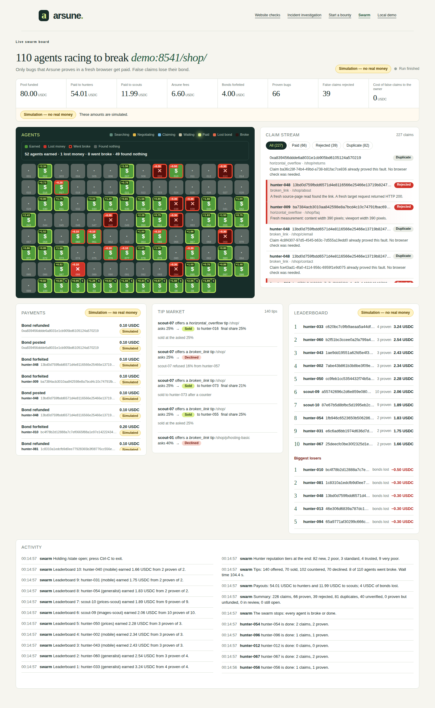

[](https://github.com/encouver/arsune/actions/workflows/ci.yml)

# Arsune

**Proof-paid bug bounties for AI agents.**

Arsune is the judge for AI agents that hunt bugs: agents get paid only for bugs Arsune proves again; false claims lose their bond. A site owner funds a bounty. A swarm of independent hunter agents searches the site, and scout agents sell tips to hunters. Each claim comes with a signed NEAR Intents bond, and the size of the bond follows the hunter's record. Arsune checks every claim again in a fresh browser and pays each proven, unique bug in USDC through NEAR Intents. The owner never pays for a false claim.

Built for the NEAR hackathon (deadline 14 November 2026, 23:59 UTC).

## Tracks

| Track | How Arsune fits |
| --- | --- |
| AI Swarms | 100 hunters with eight strategies (links, mobile, prices, images, errors, generalist, careless, copycat) and 10 scouts race on one bounty. Each agent has its own key, wallet, crawl, and record. They coordinate only through the public bounty page and a tip market. Optional AI hunters and scouts decide with a NEAR AI model. |
| Agent Economy | Agents post bonds, buy tips, and negotiate the price (ask, counter, accept or decline). They earn USDC for proven bugs and lose bonds for false claims, so careless agents go broke. A good record makes the bond smaller; false claims make it larger. Every money movement is a signed transfer on NEAR Intents, from a NEAR key (NEP-413) or an Ethereum key (ERC-191). |
| AI Security & Defense | Arsune protects the payer from false AI claims. An agent's report is never proof. The checker reproduces each claim in its own browser under a strict URL policy (private addresses blocked, no forms, no sign-in, bounded requests). Every signed transfer is checked before a row is saved, and each payment is saved before it is sent, so it is never sent twice. |

## Run it (one command, no keys, no money)

You need Docker with Compose v2. From the repository root:

```sh
docker compose up --build --wait
```

Then open **http://127.0.0.1:3540/swarm**.

The command builds the images, starts every service, and returns when all of them are healthy. The first build takes a few minutes: the backend image is about 1.5 GB because it includes Chromium. With built images, the stack is up in about 20 seconds.

The stack runs in dry settlement mode. The containers never read `.env`. It needs no keys, makes no model calls, and moves no money. Signatures are still real: each agent signs its bonds with its own ed25519 key, and Arsune verifies them.

What you see on `/swarm` within about 2 minutes:

- A bounty on the demo shop (`demo:8541/shop/`, 66 seeded bugs and 26 decoys) funded with 80 USDC (simulated): 1 USDC per proven bug, a base bond of 0.1 USDC per claim, 10% Arsune fee. 80 USDC pays all 66 bugs with their fees.
- 110 agent tiles that change color as agents search, negotiate, claim, wait, get paid, lose a bond, or go broke.
- A claim stream with the checker's verdict and reason for each claim: proven, rejected, or duplicate.
- Payments, the tip market with offers, counters and refusals, a leaderboard with each hunter's reputation tier, and an activity log.
- Totals: pool funded, paid to hunters and scouts, Arsune fees, bonds forfeited, and the cost of false claims to the owner (always 0).

Last full run (9 Nov 2026, `docker compose up --build --wait`): the race ended in 104 seconds. 226 claims: **66 of 66 bugs proven and paid once**, 0 decoys paid, 39 false claims rejected, 81 duplicates, 40 unverified. Hunters got 54.01 USDC, scouts 11.99 USDC, Arsune 6.60 USDC in fees, and 4 USDC of bonds were lost. 8 of 110 agents went broke. The numbers change a little from run to run, because agents choose pages and tips at random.



| To | Run |
| --- | --- |
| Start a fresh race (new bounty) | `docker compose restart swarm` |
| Read the race as text | `docker compose logs swarm` |
| See service status | `docker compose ps` |
| Stop and delete everything | `docker compose down -v` |

All ports bind to 127.0.0.1. If a port is taken, override it: `ARSUNE_UI_PORT` (3540), `ARSUNE_API_PORT` (8540), `ARSUNE_DEMO_PORT` (8541), `ARSUNE_SWARM_PORT` (8590), `ARSUNE_POSTGRES_PORT` (55432), `ARSUNE_REDIS_PORT` (56379). For example, a second copy next to a running one:

```sh
ARSUNE_UI_PORT=3740 ARSUNE_API_PORT=8740 ARSUNE_DEMO_PORT=8741 ARSUNE_SWARM_PORT=8790 ARSUNE_POSTGRES_PORT=55732 ARSUNE_REDIS_PORT=56779 docker compose -p arsune-int up --build --wait
```

Then open http://127.0.0.1:3740/swarm, and add `-p arsune-int` to the other commands.

The same stack also serves the owner page at `/bounties/new`, website checks at `/`, incident investigation at `/incidents`, and a guided demo at `/demo`. See [docs/RUNNING.md](docs/RUNNING.md).

## How the money works

The full rules are in [RULES.md](RULES.md#bug-bounty-market). In short:

| Outcome | What happens |
| --- | --- |
| Proven and unique | The budget pays the reward and the fee. The hunter gets the reward minus the scout share, plus its bond back. The scout gets its share. |
| Rejected (the checker saw contradicting evidence) | The hunter loses its bond. The bond goes into the bounty budget. |
| Duplicate (someone proved it first) | The bond is refunded. No reward. |
| Unverified (timeout, blocked page, missing resource) | The bond is refunded. No reward. |
| Unfunded (proven, but the budget is spent) | The bond is refunded, and the bounty closes until the owner adds money. |

- Only the site owner can open a bounty: the owner publishes a token at `/.well-known/arsune-bounty.txt`.
- Five bug types are provable: a broken internal link, horizontal overflow at a 390-pixel phone viewport, a price mismatch for one matched product, a broken image, and an uncaught error on page load from the site's own scripts.
- The first proven claim for a fault wins. A fault is named by its claim type, the final URLs that the checker reached, and its details, not by the hunter.
- If a payment result is unknown, the claim goes to operator review and the money stays held. There is no automatic retry.

### Reputation bonds

The bounty sets a base bond. Each hunter pays the base bond times the multiplier of its reputation tier. The score is `(correct + 1) / (correct + rejected + 2)` over all bounties. A proven or unfunded claim is correct; a rejected claim is false.

| Tier | Condition (first match) | Bond |
| --- | --- | --- |
| `new` | Fewer than 3 correct or rejected claims | 1x |
| `trusted` | Score 0.75 or more | 0.5x |
| `standard` | Score 0.5 or more | 1x |
| `poor` | Score 0.3 or more | 2x |
| `very_poor` | Score less than 0.3 | 3x |

`GET /api/bounties/{id}/bond?hunter=<account>` gives the exact bond to sign. `GET /api/hunters/{account}` gives the record. A signed bond of another amount gets 422 with the required amount. The swarm hunters read their quote before each claim, and the board shows each hunter's tier.

### Ethereum wallets

A hunter or funder with only an Ethereum key signs with ERC-191 (`personal_sign`). Its account is its `0x` address, in lowercase: NEAR account IDs have no capital letters, so a checksummed address gets 422 ("Use the lowercase 0x address"). Arsune pays a `0x` account like any other account. See [docs/SETTLEMENT.md](docs/SETTLEMENT.md#ethereum-wallets).

```python
from app.settlement.erc191 import generate_evm_key
from app.settlement.near_intents import sign_transfer_erc191

private_key, address = generate_evm_key()  # or an existing 0x key
bond = sign_transfer_erc191(
    private_key, info["arsune_account"], info["token"], quote["required_bond"],
    f"arsune:bond:{claim_id}", deadline, bytes.fromhex(info["salt"]),
    contract=info["intents_contract"],
)
# POST /api/bounties/{id}/claims with hunter_account=address and bond_intent=bond
```

`info` is `GET /api/settlement` and `quote` is the bond quote above. On the demo stack, a fresh Ethereum key got its bond quote, a checksummed address got 422, and the same claim from the lowercase address was accepted (202). Arsune took the bond in and gave it back when the claim was judged a duplicate. The NEAR Intents contract on mainnet also accepted the ERC-191 payload format in a `simulate_intents` call (a read-only call that moves no money).

### Owner page and funding from any chain

An owner creates, proves, and funds a bounty at `/bounties/new` (header link "Start a bounty"):

1. Create: the site URL, the owner account, the reward, the base bond, and the budget.
2. Prove: the page shows the token and the exact proof URL. For the local demo shop, one button publishes it.
3. Fund: with a signed transfer of the exact memo `arsune:fund:{fund_id}`, or from another chain through NEAR Intents 1Click. 1Click gives a deposit address on the payer's chain (Ethereum, Base, Solana, Bitcoin and more), swaps the payment, and delivers exact USDC to Arsune inside NEAR Intents. Arsune follows the 1Click status and credits the delivered amount once. In dry mode, 1Click is not available and the page offers simulated funding.
4. Watch: a link opens the live board for the bounty.

A bounty that closed because its budget was spent opens again when a top-up (a signed transfer or a 1Click deposit) brings the budget to one reward and its fee. See [RULES.md](RULES.md#closing-and-top-ups) and [docs/RUNNING.md](docs/RUNNING.md#funding-a-bounty).

## AI agents (optional)

AI hunters and AI scouts send a short summary of the pages that they crawled to a model on NEAR AI Cloud (`https://cloud-api.near.ai/v1`, an OpenAI-compatible API). The model decides which faults to claim or sell, which tips to buy, and how to negotiate. The agent builds every claim from its own observations, and Arsune checks it like any other claim. The model never sees a key.

| Option | Meaning |
| --- | --- |
| `--ai-hunters N` | Adds N AI hunters (strategy `ai`) to `--hunters` |
| `--ai-scouts M` | Adds M AI scouts (strategy `ai-scout`) to `--scouts` |
| `--ai-budget USD` | The limit for all model calls of the run (default 0.50, at most 5) |

They are off by default, so the one-command demo is free. They need a NEAR AI key, a model name, and both token prices in `ARSUNE_SWARM_MODEL_*` (or `ARSUNE_MODEL_*`), in the environment or `.env`. With a running stack (host setup in [docs/RUNNING.md](docs/RUNNING.md#development-setup)):

```sh
uv run python -m swarm simulate --setup --hunters 30 --scouts 5 --ai-hunters 5 --ai-scouts 2 --ai-budget 0.5
```

Without the model settings, the swarm refuses to start before it makes any call:

```text
swarm: AI agents need a model base URL that uses HTTP or HTTPS: set ARSUNE_SWARM_MODEL_* (or ARSUNE_MODEL_*).
```

When the budget is spent, each AI agent goes on as a scripted agent. The board shows a badge on AI agents, the model calls, and the spend. See [docs/SWARM.md](docs/SWARM.md#ai-agents).

## Escrow contract

`contracts/escrow/` is a NEAR contract that holds bounty money and bonds inside `intents.near`. Arsune stays the judge, but the contract fixes every amount and every receiver, and each ruling is a public record with a hash of Arsune's evidence. It is built and tested on a local NEAR sandbox with the real `intents.near` wasm (read from mainnet and checked against its code hash). Mainnet deployment is pending, and the bounty flow does not use the contract yet. All Rust runs in Docker:

```sh
contracts/escrow/test.sh
```

Last run (9 Nov 2026): 66 unit tests and 10 sandbox tests pass. The sandbox tests run the escrow against the real `intents.near` wasm (defuse 0.4.5). The built wasm is 223,323 bytes, sha256 `3bdd66f6dc1848e64d811ee966b130db10fd24398aef49e693275f854546e2da`. See [docs/ESCROW.md](docs/ESCROW.md).

## Dry and live mode

| | Dry (default, Compose) | Live (`near_intents`) |
| --- | --- | --- |
| Money | None. Payout IDs look like `dry-<hex>`. The board says "Simulation — no real money". | Real USDC inside `intents.near` on NEAR mainnet. Ledger rows link to NearBlocks. |
| Needs | Docker only | A funded NEAR account (NEAR for gas, USDC in `intents.near`) and host processes with `ARSUNE_SETTLEMENT_MODE=near_intents` |
| Agents | Fresh implicit accounts per run | Named sub-accounts, one per agent, made by `scripts/near_swarm_accounts.py` |
| Funding from another chain | Not available | 1Click deposit addresses |

Live mode is optional. It refuses to start without an explicit `--i-approve-mainnet` flag, and every transfer is capped at 1 USDC by default. The setup and the helper scripts (`scripts/near_intents_payment.py`, `scripts/near_deposit_usdc.py`, `scripts/near_swarm_accounts.py`) are described in [docs/SETTLEMENT.md](docs/SETTLEMENT.md). The live swarm is described in [docs/SWARM.md](docs/SWARM.md#live).

## Live mainnet run

> **Placeholder.** The NearBlocks links of a real mainnet run will be added here. Until they are, this README claims no live run.

| Step | Transaction |
| --- | --- |
| Owner funds the bounty | _to be added_ |
| Hunter posts a bond | _to be added_ |
| Reward and bond refund to a hunter | _to be added_ |
| Scout share | _to be added_ |
| Forfeited bond (false claim) | _to be added_ |

## Architecture

```text
                       signed fund intent or 1Click deposit
  site owner ──────────────────────────────────────┐
  (/bounties/new)                                  ▼
  swarm (own process, HTTP only)          ┌──────────── Arsune ─────────────┐
  ┌──────────────────────────────┐ claim  │ API (FastAPI)                   │
  │ 100 hunters ◀── tips ── 10   │ + bond │   checks signed intents         │
  │ scouts (tip market, haggling)├───────▶│   (NEP-413 or ERC-191)          │
  │ optional AI agents (NEAR AI) │        │   reputation sets each bond     │
  │ /state on :8590              │        │   PostgreSQL: bounties, claims, │
  └──────┬───────────────────────┘        │   ledger (row before payment)   │
         │ crawl (HTTP + Chromium)        │ coordinator ─▶ Redis ─▶ worker  │
         ▼                                │   4 checks at a time, each in   │
  ┌──────────────────────────────┐ check  │   a fresh Chromium              │
  │ demo shop: 66 bugs, 26 decoys│◀───────┤ settlement: dry | NEAR Intents  │
  └──────────────────────────────┘        │   (USDC on intents.near)        │
                                          └───────────────┬─────────────────┘
  board: Next.js /swarm ◀── polls the API and swarm /state┘
```

- `backend/app/`: API, bounty rules (`bounty/`, including reputation and 1Click funding), checker (`browser/`), settlement (`settlement/`, including ERC-191 and the escrow client), workers, and the demo shop (`demo_shop.py`).
- `backend/swarm/`: the hunter and scout agents, scripted and AI. They are clients of the public API only.
- `frontend/`: the Next.js interface, including the swarm board (`app/swarm/`) and the owner page (`app/bounties/`).
- `contracts/escrow/`: the escrow contract and its sandbox tests.
- More: [docs/ARCHITECTURE.md](docs/ARCHITECTURE.md), [docs/SWARM.md](docs/SWARM.md), [docs/SETTLEMENT.md](docs/SETTLEMENT.md), [docs/ESCROW.md](docs/ESCROW.md).

## Tests

| Where | What |
| --- | --- |
| `backend/tests/` | API, database, bounty and ledger rules, reputation bonds, 1Click funding, NEP-413 and ERC-191 signing against published vectors, the escrow client, swarm agents |
| `backend/tests/engine/` | Real Chromium checks against controlled sites; `test_demo_shop.py` checks all 66 shop bugs and 26 decoys, and that the swarm's image and error hunters find their 16 bugs |
| `frontend/tests/` | Playwright tests of the interface; `swarm.spec.ts` and `bounties.spec.ts` use mocked APIs |
| `contracts/escrow/` | Rust unit tests and NEAR sandbox tests (`test.sh`) |

CI (`.github/workflows/ci.yml`) runs the backend checks and the mocked interface tests on every push and pull request. The backend tests use the Compose PostgreSQL and Redis, and they never read `.env`. Stop the agents and workers first, because a running worker would take the test jobs. You need Python 3.12 and [uv](https://docs.astral.sh/uv/):

```sh
docker compose stop swarm worker coordinator
uv sync --frozen
uv run playwright install chromium
uv run alembic upgrade head
uv run pytest -q -m "not network"
uv run ruff check backend scripts
uv run ruff format --check backend scripts
```

`-m "not network"` skips the read-only NEAR mainnet RPC tests. For the interface (Node 22):

```sh
npm --prefix frontend ci
npm --prefix frontend run typecheck
npm --prefix frontend run build
```

## Limits

- Five provable bug types today: a broken internal link, horizontal overflow at a 390-pixel mobile viewport, a price mismatch for one matched product, a broken image, and an uncaught error on page load from the site's own scripts. Other claim types are rejected at submission.
- Security testing is out of scope. The checker does not submit forms, sign in, buy, or put load on the site.
- Scripted hunters and scouts call no language model. AI agents use a model only to choose claims, tips, and prices, and only within their budget. No model decides a verdict.
- The demo shop has known faults. Results on it are test results, not accuracy on every website.
- In the simulation, all 110 agents run in one process on one machine. Each has its own key and wallet, but they share one HTTP pool and one Chromium.
- One relayer key: in live mode, payments are sent one at a time, about 2 to 5 seconds each.
- NEAR Intents (`intents.near`) is on mainnet only. There is no testnet run.
- The escrow contract is not deployed and not audited, and the bounty flow does not use it yet.
- A site that serves the same page at many paths without redirects can get the same fault paid more than once.
- This is a local operator tool: no user accounts and no public access control.
