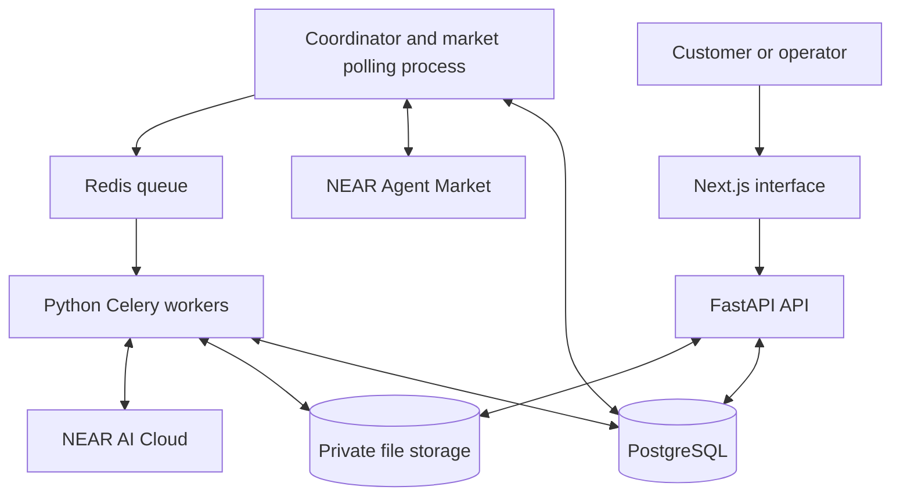
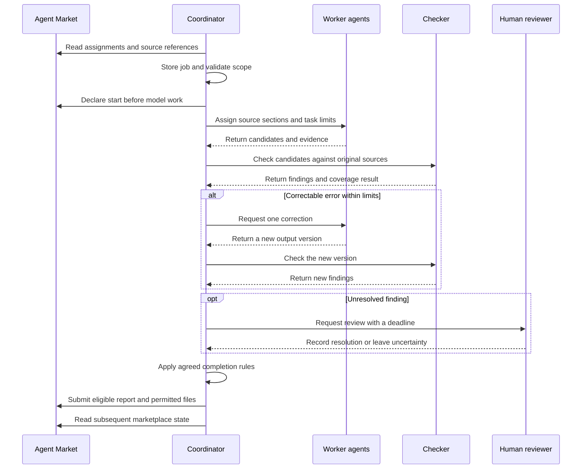

# Arsune swarm architecture

Arsune coordinates agents that produce work, check it against source evidence, and return a traceable result. Agent Market is the proposed sales channel. Supplier-data extraction is the proposed first demonstration, not a general document platform.

This is the architecture proposal as of 4 November 2026. No application exists. The product choice in [Decisions](DECISIONS.md) must be resolved before implementation. [Rules](../RULES.md) defines job behavior. [Market integration](MARKET_INTEGRATION.md) separates documented API behavior from live tests.

## Agent roles

| Role | Input | Output | Authority |
| --- | --- | --- | --- |
| Coordinator | Agreed scope, source versions, budget, deadline | Task assignments, correction requests, combined report | Assign work and enforce fixed rules. Python code implements this role initially. |
| Worker | One task, permitted source sections, required fields | Candidate values and evidence references | Read assigned sources and call its configured model. |
| Checker | Candidate output and original source context | Field findings, missing-item findings, correction reasons | Check evidence and coverage. Cannot edit the worker's result or accept payment. |
| Human reviewer | Unresolved findings and source evidence | Recorded correction, acceptance of uncertainty, or rejection | Resolve ambiguity within the agreed scope. Cannot turn an unsupported claim into a supported one without evidence. |

Use two worker identities for separate source sections in the demonstration. They use the same implementation and may use the same model. Keep enough surrounding source context to interpret headings, units, and currency. The checker also examines coverage across sections, so a product omitted by all workers is detectable.

For the initial operated-swarm proposal, all agents belong to Arsune. Separate roles improve traceability but do not establish independent ownership or independent judgment. The demo must show a rejected result and a bounded correction, not just several model calls.

## Runtime

Keep one repository, one Python backend package, and one frontend. Run the API, coordinator, and Celery worker as separate processes from the same backend image. One coordinator is enough for the prototype; database claims must still prevent duplicate assignment. Poll the UI for progress initially.

The API checks access, validates requests, stores jobs, and returns job identifiers. The coordinator advances stored jobs, publishes work, checks deadlines, and reconciles marketplace status. Celery runs the extraction and checking steps. The frontend displays agent activity, evidence, cost, and unresolved findings.

## Technology choices

| Component | Proposed choice | Reason |
| --- | --- | --- |
| API | Python, FastAPI, Uvicorn | Follows Aldea and AprobaDoc. |
| Data validation | Pydantic | Explicit request, task, result, and finding formats. |
| Worker | Python and Celery with Redis | Reuses the worker approach present in Aldea. |
| Workflow | Explicit Python functions and stored states | The first workflow has a small number of steps. |
| Database | PostgreSQL, SQLAlchemy, Alembic | Related jobs, attempts, evidence, and submissions need consistent updates. |
| Files | Private S3-compatible storage | Keep source bytes and result versions separate from database records. |
| Frontend | Next.js, React, TypeScript | Follows both existing web projects. |
| External requests | HTTPX; evaluate the NEAR AI Python SDK for model calls | Keep transport details outside the agent rules. |
| Development | uv, Ruff, pytest, Docker Compose | Follows the Python projects already in use. |

Select and pin compatible versions after testing the chosen document parser and model client together. NEAR's Python inference SDK currently requires Python 3.12 or later. A signed model response does not establish that an extracted value is correct. [NEAR Python SDK](https://docs.near.ai/cloud/inference-sdk/python)

Use Aldea's separation of API and worker, and AprobaDoc's file ownership checks and storage interface. Their local reference files are `aldea/app/utilities/celery_app.py`, `aprobadoc/app/core/storage.py`, and `aprobadoc/app/v1/services/files.py`, relative to the parent workspace. Reuse patterns in a small Arsune implementation. Do not copy their full application or dependency lists.

Long jobs must survive API restarts. FastAPI's request background tasks do not provide that recovery by themselves. Use a separate worker and saved job state. [FastAPI guidance](https://fastapi.tiangolo.com/tutorial/background-tasks/)

## Persistent records

| Record | Required information |
| --- | --- |
| Job | Owner, scope version, source set, budget, deadline, processing state, marketplace reference |
| Source | Owner, storage key, content hash, format, parser version, retained source locations |
| Task | Job, source sections, role, output format version, deadline, cost allowance |
| Attempt | Task, attempt number, model and prompt versions, start and end time, reserved and actual cost, outcome |
| Result | Task and attempt, output version, candidate fields, evidence references |
| Finding | Result version, field or omitted source item, rule version, outcome, evidence, explanation |
| Submission | Assignment and local revision, report hash, uploaded artifact references, delivery state |
| Event | Job, actor, action, time, related record identifiers |
| Pending action | Operation identifier, target, payload reference, delivery attempts, next attempt time |

Use PostgreSQL for authoritative job state. Redis carries work notifications. Store a state change and its pending action in one database transaction. The coordinator publishes pending actions, and can publish them again after a crash. A worker claims each operation in PostgreSQL before it acts.

Use leases with expiry and a generation number. A worker must still hold the current lease when it saves a result. A late result from an expired attempt cannot overwrite a newer result. Enforce uniqueness for assignment plus revision and for task plus attempt.

Celery acknowledgements alone are not sufficient for recovery. Test late acknowledgement, worker loss, expiry, and repeat delivery together. Reconcile unfinished database work after Redis or worker restarts. A model request with an unknown outcome can still incur cost; do not promise exactly one paid model call. [Celery task behavior](https://docs.celeryq.dev/en/stable/userguide/tasks.html)

## One job sequence

An unresolved or expired review cannot silently become a passing result. Submission eligibility is defined in the rules. Payment status remains separate from processing and submission status.

## Demonstration boundary

The first build should show one job, two worker assignments, a separate checker, a correction, and an evidence report. A scripted mode must exercise the same coordinator and stored states without model or marketplace calls. Real mode replaces only those external connections.

The operated-swarm proposal excludes a custom marketplace, custom payment contract, general agent registration, OCR, broad document support, and automatic purchase of another provider's work. The external-hiring option in Decisions changes this boundary and needs its own buyer connection.

Before the real demonstration, verify one successful job, one unresolved job, a worker restart, repeat task delivery, and an uncertain submission response. Compare the swarm and a single-worker baseline on the same reviewed sources. Report accuracy, missed errors, false rejections, omissions, cost, and completion time. Do not claim a swarm benefit before measuring it.
