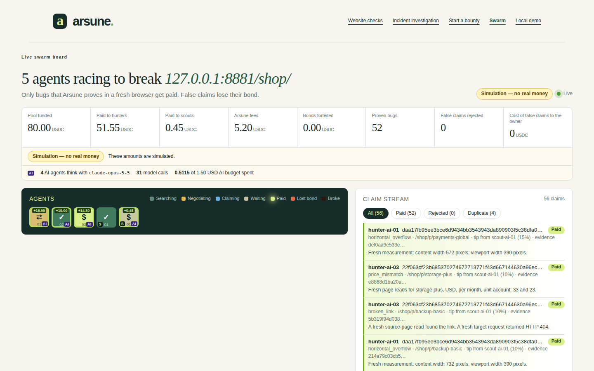

# AI model evaluation for the swarm

On 10 November 2026 we ran the same race four times. Each run used a different model for the
AI hunters and the AI scout: three Claude models through the Anthropic SDK, and `llama3:latest`
on a local GPU as a free baseline. This page gives the setup, the numbers, real decisions with
Arsune's verdicts, and which model fits which use.

## Setup

- Code: commit `48e634b` (master). The code did not change between runs. All four runs used
  the same prompts, the same agent logic and the same strict JSON parser.
- Stack: an isolated API, worker (4 checks at a time), coordinator and demo shop, in dry
  settlement mode. Each run started with a fresh database and an empty Redis database, so no
  claim, duplicate or reputation carried over.
- Agents: 3 AI hunters, 1 AI scout and 1 scripted scout (`links-scout`), with no scripted
  hunters, so the AI hunters were not starved. The scripted scout sells broken-link tips that
  the AI hunters can buy.
- Bounty: 80 USDC, reward 1 USDC per proven bug, bond 0.1 USDC.

The command (the API and the demo shop were on ports 8880 and 8881):

```sh
uv run python -m swarm simulate --setup \
  --api http://127.0.0.1:8880 --site http://127.0.0.1:8881/shop/ --state-port 8882 \
  --budget 80000000 --seed 11 --hunters 0 --ai-hunters 3 --scouts 1 --ai-scouts 1 \
  --pages 25 --pace 1 --duration 900 --ai-budget <cap>
```

| Model | Settings | `--ai-budget` |
| --- | --- | --- |
| `claude-haiku-5-5` | `ARSUNE_SWARM_MODEL_PROVIDER=anthropic`, prices 0.10 / 0.50 | 0.50 |
| `claude-sonnet-5-5` | `ARSUNE_SWARM_MODEL_PROVIDER=anthropic`, prices 2 / 10 | 1.00 |
| `claude-opus-5-5` | `ARSUNE_SWARM_MODEL_PROVIDER=anthropic`, prices 4 / 20 | 2.00 |
| `llama3:latest` | Ollama 0.3.6 on one GTX 1660 Ti, one slot; prices 0 / 0, timeout 300 s, temperature 0.2 | 0.50 |

Prices are USD per million input / output tokens. The Claude calls use low effort and at most
4,000 output tokens, as the swarm always sends them.

How we measured:

- A small wrapper around the swarm's model client recorded each call: its latency as the agent
  saw it, the token usage, the answer text, and refusals. It did not change any call. It ran
  the same way for every model.
- A seeded bug is "in view" when one AI agent read every page that the bug needs (the source
  page of a broken link; both pages of a price mismatch). Recall is the share of the bugs in
  view that an AI hunter proved.
- Precision is proven / (proven + rejected).
- Tip and negotiation counts come from the swarm's tip board and log.

## Results

| | `claude-haiku-5-5` | `claude-sonnet-5-5` | `claude-opus-5-5` | `llama3:latest` |
| --- | --- | --- | --- | --- |
| Wall time | 70.8 s | 66.0 s | 130.6 s | 504.5 s |
| AI claims | 32 | 53 | 39 | 33 |
| Proven | 31 | 52 | 37 | 31 |
| Rejected (bond lost) | 0 | 0 | 0 | 1 |
| Duplicates | 1 | 1 | 2 | 0 |
| Unverified (bond refunded) | 0 | 0 | 0 | 1 |
| Precision | 100% | 100% | 100% | 97% |
| Seeded bugs in view of any AI agent | 57 | 60 | 55 | 56 |
| Proven of those (recall) | 31 (54%) | 52 (87%) | 37 (67%) | 29 (52%) |
| Seeded bugs in view of an AI hunter | 52 | 54 | 47 | 50 |
| Proven of those (recall) | 31 (60%) | 52 (96%) | 35 (74%) | 27 (54%) |
| Proven from own finds / AI-scout tips / scripted-scout tips | 31 / 0 / 0 | 51 / 1 / 0 | 26 / 11 / 0 | 15 / 7 / 9 |
| Decoys claimed | 0 | 0 | 0 | 0 |
| AI hunters' tip decisions: accept / counter / walk | 0 / 0 / 90 | 0 / 4 / 68 | 0 / 18 / 96 | 17 / 28 / 5 |
| Tips (all scouts): offered / countered / sold | 30 / 0 / 0 | 30 / 2 / 1 | 39 / 15 / 11 | 21 / 12 / 16 |
| AI scout: tips offered / sold | 20 / 0 | 20 / 1 | 25 / 11 | 8 / 7 |
| AI scout's answers to counters | none | 1 accept, 1 refuse | 11 accept | 6 accept |
| Model calls (hunter / scout / counter) | 40 (36 / 4 / 0) | 37 (31 / 4 / 2) | 58 (43 / 4 / 11) | 39 (29 / 4 / 6) |
| Hunter calls with tips only, no new pages | 20 | 12 | 28 | 14 |
| Answers dropped: not JSON | 0 | 4 | 0 | 0 |
| Answers with invalid items (items dropped) | 0 | 0 | 1 (1) | 17 (19) |
| Refusals | 0 | 1, answered by the server fallback | 0 | 0 |
| Latency per call, median / p90 | 3.2 s / 5.8 s | 2.8 s / 4.1 s | 5.1 s / 6.9 s | 44.7 s / 63.2 s |
| Tokens in / out | 60,264 / 27,974 | 55,928 / 11,731 | 73,047 / 24,101 | 34,318 / 3,684 |
| USD spent (swarm accounting) | 0.0200 | 0.2292 | 0.7742 | 0 |
| USD from tokens x price | 0.0200 | 0.2292 | 0.7742 | 0 |
| USD per proven bug | 0.0006 | 0.0044 | 0.0209 | 0 |
| Calls per hour, back-to-back races | 2,034 | 2,018 | 1,599 | 278 |
| USD per hour, back-to-back races | 1.02 | 12.50 | 21.34 | 0 (one GPU) |

Notes on the table:

- No run hit its AI budget. No agent went on as a scripted agent. Every run ended because every
  agent was done.
- A tip decision in an answer is dropped when the tip is gone or the hunter has 3 open claims.
  So the board can show fewer counters than the answers name (Opus: 18 named, 15 made).
- The Claude latency is the API time: 4 AI agents share 4 call slots, so no call waited. The
  llama latency includes the wait in Ollama's one-slot queue.
- The 4 Sonnet answers that were dropped all had valid JSON after one or two sentences of prose.
  The parser takes only a JSON object (or a fenced one), so the agent took no action on 2 pages
  and 15 tips.
- The Sonnet refusal was on one counter-offer answer. The server fallback answered it with
  `claude-sonnet-5` at the same prices. The agent saw a normal answer.
- The USD cross-check uses the usage that each response reported, times the price. It matches
  the swarm's accounting. We did not compare it with the Anthropic invoice.
- Total Claude spend: 1.0234 USD (Haiku 0.0200, Sonnet 0.2292, Opus 0.7742).

## Decisions, with Arsune's verdict

### `claude-haiku-5-5`

| Agent and its words | Verdict |
| --- | --- |
| `hunter-ai-03`: "/shop/c/hosting lists Hosting Scale at USD 29 per month; /shop/p/hosting-scale lists it at USD 39; claiming price_mismatch" | Proven: fresh reads 29 and 39 |
| `hunter-ai-01` (note): "No page_error claim: E1 on p6 does not say whether its script is from the site's own origin, so I cannot confirm it counts." | Not claimed. The TypeError on /shop/c/hosting is a seeded bug. Haiku claimed none of the 6 page errors. |
| `hunter-ai-01` (note): "Left out p3, p4 and p6 overflow claims because I have only 3 open-claim slots." | Not claimed. The overflows on /shop/c/support and /shop/p/support-basic were never claimed in this run. |
| Tips: "No observations are provided to verify the price. Scout has 0 proven tips." | The hunters walked away 90 times. No tip was sold. |

### `claude-sonnet-5-5`

| Agent and its words | Verdict |
| --- | --- |
| `hunter-ai-03`: "/shop/c/hosting raises TypeError: Cannot read properties of undefined (reading 'items') on load; claiming page_error" | Proven: a fresh load raised the same error. Sonnet proved 5 of the 6 page errors. |
| `hunter-ai-03` countered two broken-image tips on /shop/team: "10% instead of 25%, because Image fault is visible in my own observations; the tip adds little". `scout-ai-01` refused for ceo.jpg ("that's concrete evidence worth more than 10%"; this answer came from the fallback model) and accepted for support-lead.jpg | Proven, but a poor buy: the hunter had already queued support-lead.jpg from its own crawl, and paid 0.1 USDC of its reward for it. |
| `hunter-ai-02`: "I claim only the broken image on /shop/, the one fault the observations let me name with ids. …" followed by the JSON | Dropped: "the answer is not valid JSON". It happened 4 times in 37 calls. |

### `claude-opus-5-5`

| Agent and its words | Verdict |
| --- | --- |
| `hunter-ai-01` countered: "20% instead of 30%, because Scout has a perfect record, but I have no crawled ids for /shop/c/payments"; `scout-ai-01`: "20% beats a lower re-ask. The evidence is specific: /shop/c/payments links to item-16, which returns 410." | Proven; the scout earned 0.2 USDC. All 11 tips that Opus bought were proven. |
| `scout-ai-01` accepted 15%: "Correction: my record is 8 proven of 9, not 6 of 9." | The scout read its own record from the prompt and corrected the hunter's stale figure. |
| `hunter-ai-01` (note): "I can hold only 3 open claims, so the /shop/c/security HTTP 410 link and the Support Scale 47 vs 37 price gap wait for a later round." | The /shop/c/security link was never claimed: the agent does not show a reviewed page to the model again. |
| `hunter-ai-03` (note): "I left out the TypeError on /shop/faq because the observations do not show that the site's own script raised it." | Not claimed. It is a seeded bug. |

### `llama3:latest` (baseline)

| Agent and its words | Verdict |
| --- | --- |
| `hunter-ai-03`: "/shop/c/support lists Support Plus at USD 27, /shop/p/support-plus at USD 37; claiming price_mismatch" | Proven: fresh reads 27 and 37 |
| `hunter-ai-01`: "/shop/c/payments lists USD 53, /shop/p/payments-global also lists USD 53; claiming price_mismatch" | Rejected, bond lost: fresh reads 53 and 53 |
| `hunter-ai-01`: "/shop/p/payments-global is 572 px wide on a 390 px phone; claiming horizontal_overflow", with the page id of /shop/ | The claim on /shop/ was unverified (bond refunded). /shop/ fits the phone; the model mixed up the page ids. |
| `hunter-ai-01`: "evidence; accepting scout-01's 30%" | Proven, but the reason is empty. The llama hunters paid the full ask 7 times, and bought 9 of their 31 proven bugs from the scripted scout. |

## What every model ran into

These come from the agent code, not from one model. They lower recall for all four. We did not
change them, so that every model ran the same code. [After fixes](#after-fixes) gives the fixes
for problems 1 to 4 and two reruns.

1. The prompt shows "Open claims: N of 3". Many answers read it as a limit for the answer
   ("I can hold only 3 open claims"). The agent can queue more claims, but it never shows a
   reviewed page to the model again, so the faults that the model leaves "for later" are lost.
   At least 3 Haiku, 1 Sonnet and 9 Opus answers said so.
2. The page summary marks only an error from another origin's script. A first-party error has
   no mark, and Haiku and Opus read that as "origin unknown". They skipped page errors that
   Sonnet claimed and proved.
3. A hunter calls the model whenever a fresh tip is on offer, even with no new page. Tips do
   not show their pages before a sale, so many of these calls end in "walk". Opus made 28
   such calls of 43.
4. The parser takes only a JSON object. Sonnet sometimes wrote a sentence before the JSON.
   Structured outputs, or reading the last JSON object in the text, would have kept all 4
   answers.
5. All three hunters start on the same page, and every model claimed its broken image in the
   first answer. A hunter drops a fault that the public page shows as claimed, but claims in the
   same second still race: in the Opus run, 2 of the 3 became duplicates.

## After fixes

Later on 10 November we fixed problems 1 to 4 and one board problem (beads `arsune-p28.22` to
`arsune-p28.26`):

| Commit | Change |
| --- | --- |
| `9a0febb` | Problem 4: when an answer is not only JSON, the parser takes the first complete JSON object in the text. The agent still checks every field. |
| `60f09a5` | Problem 2: each page error says "from the site's own script" or "from another origin's script", and the fault list says that the first one is a fault. |
| `4bcc781` | Problem 3: tips on offer wait for the next page review. After its crawl, a hunter calls the model for tips alone only when 4 are on offer or no scout still searches. |
| `7879390` | Problem 1: the prompt tells the model to list every fault that it can prove, up to 10 in each answer. The agent queues the claims above the limit of 3 open claims. A page that still shows a fault that nobody claimed comes back once, under "Pages again", when a claim slot is free. |
| `984a1ee` | The board shows tile amounts up to 999.99 in full (the old screenshot showed "+13.1("). |

Then we ran `claude-haiku-5-5` and `claude-opus-5-5` again on commit `984a1ee`, with the setup
above: the same command, seed, pages, prices and isolated stack, and a fresh database and Redis
database for each run. Only the AI budget caps were lower: 0.25 USD for Haiku and 1.50 USD for
Opus. Problem 5 is not fixed.

| | Haiku, first | Haiku, after fixes | Opus, first | Opus, after fixes |
| --- | --- | --- | --- | --- |
| Wall time | 70.8 s | 57.9 s | 130.6 s | 86.5 s |
| AI claims | 32 | 55 | 39 | 56 |
| Proven | 31 | 54 | 37 | 52 |
| Rejected (bond lost) | 0 | 0 | 0 | 0 |
| Duplicates | 1 | 1 | 2 | 4 |
| Unverified (bond refunded) | 0 | 0 | 0 | 0 |
| Precision | 100% | 100% | 100% | 100% |
| Seeded bugs in view of any AI agent | 57 | 58 | 55 | 55 |
| Proven of those (recall) | 31 (54%) | 54 (93%) | 37 (67%) | 52 (95%) |
| Seeded bugs in view of an AI hunter | 52 | 57 | 47 | 48 |
| Proven of those (recall) | 31 (60%) | 54 (95%) | 35 (74%) | 48 (100%) |
| Proven from own finds / AI-scout tips / scripted-scout tips | 31 / 0 / 0 | 54 / 0 / 0 | 26 / 11 / 0 | 48 / 4 / 0 |
| Decoys claimed | 0 | 0 | 0 | 0 |
| AI hunters' tip decisions: accept / counter / walk | 0 / 0 / 90 | 0 / 0 / 41 | 0 / 18 / 96 | 0 / 27 / 36 |
| Tips (all scouts): offered / countered / sold | 30 / 0 / 0 | 30 / 0 / 0 | 39 / 15 / 11 | 40 / 16 / 5 |
| AI scout: tips offered / sold | 20 / 0 | 20 / 0 | 25 / 11 | 22 / 5 |
| AI scout's answers to counters | none | none | 11 accept | 5 accept, 1 refuse |
| Model calls (hunter / scout / counter) | 40 (36 / 4 / 0) | 18 (14 / 4 / 0) | 58 (43 / 4 / 11) | 31 (21 / 4 / 6) |
| Hunter calls with tips only, no new pages | 20 | 1 | 28 | 9 |
| Hunter calls with "Pages again" (pages) | - | 3 (7) | - | 0 (0) |
| Answers dropped: not JSON | 0 | 0 | 0 | 0 |
| Answers with invalid items (items dropped) | 0 | 0 | 1 (1) | 1 (1) |
| Refusals | 0 | 0 | 0 | 0 |
| Latency per call, median / p90 | 3.2 s / 5.8 s | 5.4 s / 7.1 s | 5.1 s / 6.9 s | 5.3 s / 9.2 s |
| Tokens in / out | 60,264 / 27,974 | 38,539 / 20,251 | 73,047 / 24,101 | 48,518 / 16,309 |
| USD spent (swarm accounting) | 0.0200 | 0.0140 | 0.7742 | 0.5203 |
| USD from tokens x price | 0.0200 | 0.0140 | 0.7742 | 0.5203 |
| USD per proven bug | 0.0006 | 0.0003 | 0.0209 | 0.0100 |
| Calls per hour, back-to-back races | 2,034 | 1,119 | 1,599 | 1,290 |
| USD per hour, back-to-back races | 1.02 | 0.87 | 21.34 | 21.65 |

What changed:

- Recall: the Haiku hunters proved 95% of the seeded bugs in their view (60% before), and the
  Opus hunters proved all 48 (74% before). Haiku proved all 6 page errors; in its first run it
  proved none. Opus proved the 5 page errors in its view.
- Problem 1: no Opus answer left a fault for later. Answers listed up to 9 claims, and the
  agent queued them. 2 of 14 Haiku answers still listed 3 claims and put 5 more faults in the
  note as "queued for later claims". Those pages came back under "Pages again" (3 calls, 7
  pages) and gave 2 more claims. Other hunters had claimed the rest by then
  (`arsune-p28.28`).
- Problem 3: calls with tips only fell from 20 to 1 (Haiku) and from 28 to 9 (Opus). The 9 Opus
  calls came after the crawl, with up to 4 tips each. In each of them the model wrote that it
  had no page observations, then countered or walked away.
- Calls and cost: each race made about half the calls and ended sooner. A Haiku race cost
  0.0140 USD (0.0200 before) and an Opus race 0.5203 USD (0.7742 before). The cost per proven
  bug fell by half. The cost per hour of back-to-back Opus races stays about the same, because
  each race is shorter.
- Trading: Opus sold 5 tips (11 before), all from the AI scout at 10% or 15%. 4 were proven;
  the fifth was a duplicate: another hunter claimed the same overflow in the same second.
  Its hunters found more faults first (48 own finds, 26 before). The scripted scout refused
  all 10 of its counters at 10% or 12%, below its floor of 20% or 23%. Haiku still walked away
  from every tip.
- Duplicates: 3 of the 4 Opus duplicates came in the first 5 seconds of claims. Two hunters
  claimed the same faults from the pages that both read first: the start page, /shop/shipping
  and /shop/c/support (problem 5).
- Problem 4 did not show: every Haiku and Opus answer was only JSON. Unit tests cover the new
  parser path.
- A new limit: an image that answers HTTP 200 but does not decode shows as "HTTP 200 shown".
  9 Haiku answers left such an image out because it answers HTTP 200. Haiku proved 6 of the 9
  broken images in its hunters' view; Opus proved 10 of 10 (`arsune-p28.27`).
- Spend for the two reruns: 0.5342 USD (Haiku 0.0140, Opus 0.5203), by the swarm's accounting.
  The four first runs and the reruns together: 1.5576 USD.

The choices below hold. Opus is still the demo model: 52 proven bugs, the Claude model that
trades most, 87 s and 0.52 USD a race. Haiku still fits a hosted demo: 54 proven bugs for
0.014 USD a race, but no trade. We did not run Sonnet again.

## Which model fits

**(a) The judge demo or video: `claude-opus-5-5`.** Every answer was valid JSON, no claim was
false, and it is the only Claude model that traded: 15 counter-offers, 11 tips sold, all 11
proven. Its reasons and the scout's answers read well on the board. A race takes about two
minutes and cost 0.77 USD. `claude-sonnet-5-5` found more bugs (52, 96% of what its hunters saw)
in half the time for 0.23 USD, but almost did not trade, and 4 of its 37 answers showed on the
board as "the answer is not valid JSON". Choose Sonnet when the parser reads JSON after prose.

**(b) A hosted demo with real traffic: `claude-haiku-5-5`.** One race cost 0.02 USD. Races back to
back at the observed rate (about 2,000 calls an hour) cost about 1.02 USD an hour. It made no
false claim and no call failed. Its limits: it walked away from every tip, so the AI market
stays quiet, and it proved 31 of the 57 bugs in view. At the same rate, Sonnet costs about 12.50
USD an hour and Opus about 21.34 USD an hour. `llama3:latest` costs nothing, but one small GPU
answers about 4.6 calls a minute, so a race takes about 8.4 minutes and one race runs at a time.



The board near the end of the `claude-opus-5-5` rerun after the fixes: 52 proven bugs, 31 model
calls, 0.51 USD. (We painted out the Next.js dev-tools button in the bottom left corner.)

## Limits of this evaluation

- One run per model. The numbers move from run to run. A difference of a few bugs is not a
  result.
- `--seed 11` fixes the agents' traits and their first steps only. The crawl and the think time
  share one random source, so the pages that each agent read differ after its first few
  pages. We compare recall on the bugs in view to correct for this, not the raw counts.
- Timing changes the market. A fast hunter finds a fault before it buys the tip; a slow hunter
  gets more offers. This favours trading for slow models.
- The demo shop is small and labelled. Its 66 bugs and 26 decoys test the five claim types
  only. A real site would need longer prompts and more calls.
- The race had no scripted hunters. With scripted hunters, as in the default race, the AI
  hunters find fewer bugs first.
- The llama numbers come from one GTX 1660 Ti and Ollama 0.3.6. Another GPU changes the time,
  not the cost.
